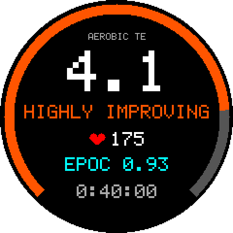

# vwatch

A virtual machine for smartwatch firmware. Write a watch face or app in C
against a small SDK, boot it on an emulated Cortex-M4, and watch it draw.

> Status: early, but usable: SDK, emulator, desktop VM window with live
> reload, and a headless host for tests and activity replay.

Bring your own editor: keep VS Code (or anything) on one half of the screen
and the vwatch window on the other. Save a file and vwatch rebuilds and
reboots the watch, like live-reloading an HTML page.


## The VM window

```
brew install qemu qtbase cmake         # plus the Arm GNU toolchain (arm-none-eabi-gcc)
cmake -S app -B app/build && cmake --build app/build
app/build/vwatch examples/hello_face   # a project dir (live reload) or a .elf
```

Open the same folder in your editor. On every save vwatch runs `make`, and
on success it reboots the watch with the new firmware. A failed build leaves
the previous firmware running and prints the compiler errors in the serial
console. A firmware that hangs inside `app_tick()` is caught by a 3-second
watchdog.

- **Buttons:** click the bezel buttons, or use L / ↑ / ↓ / Return / Esc.
- **Sensors:** heart rate and speed sliders in the toolbar.
- **Machine menu:** pause, reset, rebuild, speed 1x–300x.

## How it works

```
 your app.c ──► vwatch SDK + runtime ──► Cortex-M4 ELF ──► QEMU mps2-an386
                                                              │  UART0
 host (vwhost.py / desktop app) ◄── screen regions, logs ─────┘
                                 ──► ticks, sensors, buttons ─►
```

- **SDK** (`sdk/include/vwatch.h`): implement `app_init`, `app_tick`,
  `app_button`. Draw into a 240×240 round display with 64 colours (RGB222,
  the depth of transflective watch screens): rects, lines, circles, arcs, a
  bitmap font. Read heart rate, speed and cadence; log to the console.
- **Runtime**: owns `main()`, runs the event loop, and after every tick
  ships only the screen region that changed.
- **Protocol** (`sdk/include/vw_proto.h`): small framed binary messages over
  the emulated UART. Lockstep: the host sends a tick and waits for
  `TICK_DONE`, so pause, speed and replay are deterministic.
- **Port layer** (`sdk/port/<target>/`): UART, startup and linker script per
  target. `qemu-mps2` today; real hardware ports go here.

## Examples

| | |
|---|---|
|  |  |
| `hello_face`: clock, seconds ring, heart rate, stopwatch | `te_screen`: live Aerobic Training Effect from heart rate (EPOC model) |

## Headless (tests, CI, activity replay)

Needs `arm-none-eabi-gcc`, `make` and `qemu-system-arm`.

```
cd examples/hello_face
make            # -> build/hello_face.elf  (~7 KB code)
make run        # boot in QEMU headless, 12 ticks, save build/hello_face.png
```

Minimal app:

```c
#include <vwatch.h>
VW_APP_NAME("my_face");

void app_init(void) {}
void app_tick(void) {
    vw_clear(VW_BLACK);
    vw_text_centered(120, 100, "HELLO", VW_WHITE, 4);
    vw_arc(120, 120, 118, 6, 0, vw_millis() / 1000 % 60 * 6.0f, VW_ORANGE);
}
void app_button(int b, int down) { (void)b; (void)down; }
```

## Tests

```
python3 tests/test_hello_face.py
python3 tests/test_te_screen.py [activity.fit]
```

Replay a recorded activity (needs `pip install fitdecode`):

```
python3 host/vwhost.py examples/te_screen/build/te_screen.elf --fit run.fit --every 5 --png out.png
```

## Roadmap

1. ~~SDK, runtime, protocol, QEMU port, headless host~~
2. ~~VM window (C++/Qt): live watch screen, bezel buttons, sensor sliders,
   serial console, live reload on save~~
3. Activity replay: ~~headless (`vwhost.py --fit`)~~, then in the VM window
4. Deploy targets: [PineTime](https://pine64.org/devices/pinetime/) (open hardware, native firmware;
   flashing is at your own risk) and Garmin via a Connect IQ export (sandboxed app, no firmware changes)

vwatch does not modify or flash proprietary watch firmware.

## License

MIT
